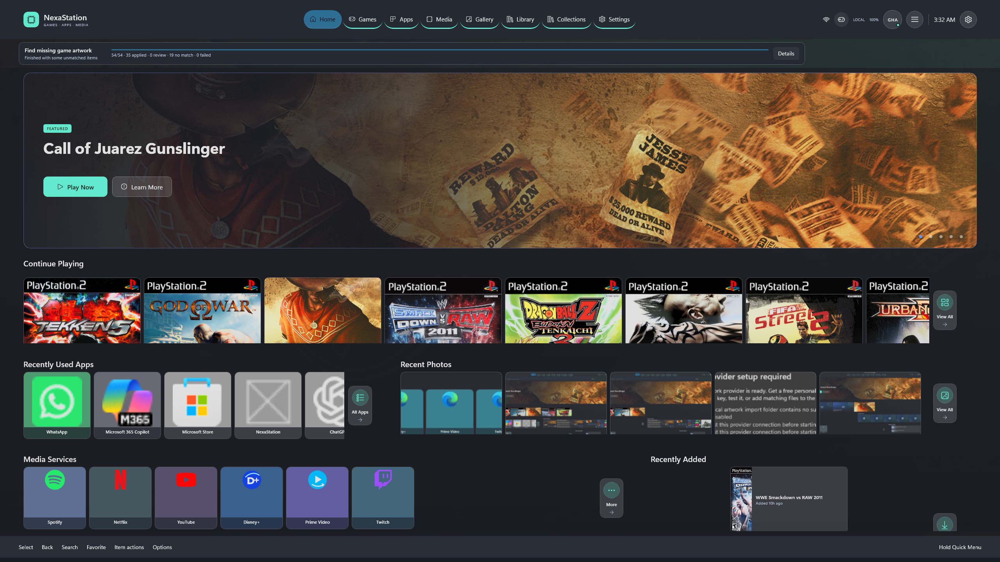

# NexaStation

NexaStation is a fullscreen Windows launcher built for the couch. It brings games, apps, emulators, media, and local photos into one controller-friendly home screen without replacing the Windows shell or taking control of your files.



## The idea

Windows can run almost anything, but it rarely feels at home on a television or handheld. NexaStation aims to keep that flexibility while giving the whole experience a simple, console-like front end.

The project is guided by a few goals:

- Make the main experience comfortable with a controller from across the room.
- Keep games, apps, media, and emulators in one organized library.
- Work offline and keep personal library data on the device.
- Respect the software and files already on the PC.
- Make imports, artwork downloads, capture, and system actions visible and user-controlled.
- Stay recoverable: settings, backups, and safe fallbacks should prevent a broken interface from trapping the user.

## Features

### Deliberate first-time setup

The five-screen Setup Assistant personalizes the local Owner profile, appearance, providers, Windows apps, emulation, Gallery, and startup behavior. Every item requires a clear **Set up** or **Not now** decision, approved sources show a local preview before import, and a final review explains exactly what will change.

### One library for everything

Add games, Windows applications, web apps, media shortcuts, and custom URIs. Items can be edited, favorited, hidden, placed on Shelves, pinned, or given custom artwork. Removing an item only removes it from NexaStation; it never uninstalls the app or deletes the original file.

### My Stuff

My Stuff keeps personal organization in one place. Build mixed-content Shelves from games, apps, photos, videos, Gallery albums, and nested Shelves; use Dynamic Shelves for rule-based views; and track game progress or a video queue with clear statuses. Favorites, recently added items, and automatic provider or emulator Shelves stay separate and easy to scan.

### Game and app discovery

- Import a Steam library without requiring Steam credentials or a web API.
- Scan Start Menu entries and supported packaged Windows apps.
- Discover installed Epic, GOG, Ubisoft Connect, EA app, and Battle.net titles through read-only local scans.
- Review candidates before importing and keep manual changes when a source is refreshed.
- Detect likely duplicates without silently merging them.

### Emulation

NexaStation supports Dolphin, PCSX2, PPSSPP, RetroArch, custom emulator definitions, and an experimental manually configured RPCS3 path. Multiple installations of the same emulator can coexist, and game folders can be scanned without changing emulator settings or ROM files.

See the [emulation guide](docs/emulation.md) and [adapter documentation](docs/emulator-adapters.md).

### Controller-first navigation

- Full keyboard, mouse, touch, and controller navigation.
- Input prompts that adapt to the most recently used device.
- Configurable controller mappings, prompt styles, repeat behavior, and deadzones.
- An on-screen keyboard for controller-driven search and text entry.
- A Quick Menu for common actions without leaving the current screen.
- Focus recovery after dialogs, item removal, and page changes.

### A customizable home screen

The Home dashboard can surface featured games, continue-playing items, recent apps, photos, media services, favorites, and recently added content. Layouts, sections, themes, interface scale, and performance presets can be adjusted without rebuilding the library.

NexaStation includes its modern dashboard and a classic crossbar-style theme. The crossbar experience is still being expanded, so some screens currently use the main Nexa presentation.

### Artwork and metadata

Local cover art works offline. Optional metadata providers can fill missing artwork while preserving user-selected and locked images. Provider keys are stored in Windows Credential Manager, ambiguous matches are held for review, and bulk jobs can be resumed safely.

### Gallery and media

Add approved folders to browse local photos and videos from the couch. NexaStation creates rebuildable thumbnails, leaves the source files untouched, and can keep private sources out of Home and global discovery. Local video playback includes controller controls, resume progress, subtitles, audio-track selection, and an Open With fallback for unsupported formats.

### Activity, backup, and recovery

- Local play-session history and total playtime.
- A privacy-filtered activity timeline.
- Backup archives with a validated SQLite snapshot and SHA-256 manifest.
- Automatic safety backups before database migration, restore, or reset work.
- Recovery tools for damaged settings, interrupted sessions, and startup problems.

### Windows integration with guardrails

NexaStation can show controller, network, audio, display, and current-activity information. Optional desktop controller mode and power actions are deliberately limited and require clear user choices. The app does not elevate itself, inject arbitrary scripts, replace Explorer, or attempt to control protected windows.

## Local-first by design

Your library, play history, settings, profiles, and Gallery index stay under `%LocalAppData%\NexaStation`. Library data and captures are not uploaded automatically. Remote artwork and metadata are opt-in, and capture only happens after a direct user action.

Read [PRIVACY.md](PRIVACY.md) and [SECURITY.md](SECURITY.md) for the full boundaries.

## Getting started

NexaStation currently targets Windows with C#/.NET 10, WinUI 3, and Windows App SDK 2.2.

```powershell
dotnet restore NexaStation.sln
dotnet build NexaStation.sln -c Debug -p:Platform=x64
dotnet test NexaStation.sln -c Debug -p:Platform=x64
```

For development, open `NexaStation.sln` in Visual Studio, select the packaged `NexaStation.App` x64 profile, and press F5. Developer Mode is required for loose package registration.

See the [installation guide](docs/installation.md), [architecture overview](docs/architecture.md), and [manual testing guide](docs/manual-testing.md) for more detail.

## Main controls

| Input | Action |
|---|---|
| Arrows / W A S D / D-pad / left stick | Navigate |
| Enter / Space / controller A | Confirm or launch |
| Escape / Back / controller B | Go back or cancel |
| Q / E / LB / RB | Previous or next section |
| X / controller X | Open item actions |
| F | Favorite the focused item |
| F11 | Toggle fullscreen |
| Ctrl+Q / controller Menu | Open or close Quick Menu |
| Ctrl+Shift+D | Development exit from fullscreen |
| Alt+F4 | Exit NexaStation |

## Project status

NexaStation is a development preview. The core library, imports, controller navigation, customization, Gallery, media playback, local persistence, backup, and recovery systems are in place, but hardware and launcher behavior still varies between PCs.

Known limitations include:

- Steam and other launcher process handoffs are best-effort and can need manual rules.
- Web apps open in the default browser; NexaStation does not track browser-tab lifetime.
- Gallery codec support depends on the codecs installed in Windows.
- Desktop controller mode cannot operate elevated or protected windows.
- There is no cloud sync, embedded web browser, media editor, or silent application management.
- Development packages are unsigned and controller coverage still needs testing across more hardware.

Public packaging is intentionally on hold until a project license is selected. See [LICENSE-DECISION.md](LICENSE-DECISION.md).

## Contributing

Bug reports, compatibility results, documentation fixes, and focused pull requests are welcome. Start with [CONTRIBUTING.md](CONTRIBUTING.md), and review the safety and privacy boundaries before changing discovery, launch, capture, or system-integration behavior.
